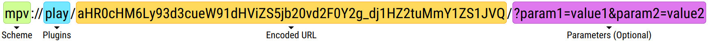

[English][readme-en] | [简体中文][readme-zh-hans] | [繁体中文][readme-zh-hant]

[readme-en]: https://github.com/akiirui/mpv-handler/blob/main/README.md
[readme-zh-hans]: https://github.com/akiirui/mpv-handler/blob/main/README.zh-Hans.md
[readme-zh-hant]: https://github.com/akiirui/mpv-handler/blob/main/README.zh-Hant.md

# mpv handler

A protocol handler for **mpv**, written by Rust.

Use **mpv** and **yt-dlp** to play video and music from the websites.

Please use it with userscript:

[![play-with-mpv][badges-play-with-mpv]][greasyfork-play-with-mpv]

## Breaking changes

### [v0.4.0][v0.4.0]

To avoid conflicts with the `mpv://` protocol provided by mpv.

> mpv://...
>
> mpv protocol. This is used for starting mpv from URL handler. The protocol is stripped and the rest is passed to the player as a normal open argument. Only safe network protocols are allowed to be opened this way.

Scheme `mpv://` and `mpv-debug://` are deprecated, use `mpv-handler://` and `mpv-handler-debug://`.

**Require manual intervention**

#### Windows

Run `handler-uninstall.bat` to uninstall deprecated protocol, and run `handler-install.bat` to install new procotol.

#### Linux

If you installed manually, please repeat the manual installation process.

## Protocol



### Scheme

- `mpv-handler`: Run mpv-handler without console window
- `mpv-handler-debug`: Run mpv-handler with console window to view outputs and errors

### Plugins

- `play`: Use mpv player to play video

### Encoded Data

Use [URL-safe base64][rfc-base64-url] to encode the URL or TITLE.

Replace `/` to `_`, `+` to `-` and remove padding `=`.

Example (JavaScript):

```javascript
let data = btoa("https://www.youtube.com/watch?v=Ggkn2f5e-IU");
let safe = data.replace(/\//g, "_").replace(/\+/g, "-").replace(/\=/g, "");
```

### Parameters (Optional)

```
cookies  = [ www.domain.com.txt ]
profile  = [ default, low-latency, etc... ]
quality  = [ 2160p, 1440p, 1080p, 720p, 480p, 360p ]
v_codec  = [ av01, vp9, h265, h264 ]
v_title  = [ Encoded Title ]
subfile  = [ Encoded URL ]
startat  = [ Seconds (float) ]
referrer = [ Encoded URL ]
```

## Installation

### Linux

#### Arch Linux

[![mpv-handler][badges-aur]][download-aur]
[![mpv-handler-git][badges-aur-git]][download-aur-git]

#### Manual installation

1. Download [latest Linux release][download-linux]
2. Unzip the archive
3. Copy `mpv-handler` to `$HOME/.local/bin`
4. Copy `mpv-handler.desktop` to `$HOME/.local/share/applications/`
5. Copy `mpv-handler-debug.desktop` to `$HOME/.local/share/applications/`
6. Set executable permission for binary
   - ```
     $ chmod +x $HOME/.local/bin/mpv-handler
     ```

7. Register xdg-mime (thanks for the [linuxuprising][linuxuprising] and [muse90673#122][muse90673])
   - ```
     $ xdg-mime default mpv-handler.desktop x-scheme-handler/mpv-handler
     $ xdg-mime default mpv-handler-debug.desktop x-scheme-handler/mpv-handler-debug
     $ update-desktop-database $HOME/.local/share/applications/
     ```

8. Add `$HOME/.local/bin` to your environment variable `PATH`
9. **Optional**: _Copy `config.toml` to `$HOME/.config/mpv-handler/config.toml` and configure_

### macOS

macOS cannot register a bare executable as a protocol handler, so the binary
has to be wrapped in an `.app` bundle. `install.sh` assembles that bundle,
ad-hoc signs it and registers it with LaunchServices.

1. Install **mpv** and **yt-dlp**
   - ```
     $ brew install mpv yt-dlp
     ```

2. Unpack the archive for your Mac. Manual GitHub Actions builds on a branch
   containing the macOS workflow provide both ZIPs in the `macos-packages` artifact.

   - Apple Silicon — `unzip mpv-handler-macos-arm64.zip -d mpv-handler-macos`
   - Intel — `unzip mpv-handler-macos-amd64.zip -d mpv-handler-macos`

3. Run the installer from the extracted directory
   - ```
     $ cd mpv-handler-macos
     $ sh install.sh ./mpv-handler
     ```

   The bundle goes to `$HOME/Applications`, which needs no administrator
   rights. Pass a second argument to install for every user of this machine
   - ```
     $ sh install.sh ./mpv-handler /Applications
     ```

4. **Optional**: _Copy `config.toml` to `${XDG_CONFIG_HOME:-$HOME/.config}/mpv-handler/config.toml` and configure_

For a personal installation, `install.sh` saves an absolute `$XDG_CONFIG_HOME`
from your shell so the app can use it when you open a browser link. Re-run
`install.sh` if you set, change, or unset that variable. A shared installation
in `/Applications` uses each user's `$XDG_CONFIG_HOME` at launch if it is an
absolute path, or that user's `~/.config` otherwise.

To install from source, use a checkout that contains `share/macos/install.sh`.
From its root, run `cargo build --release --locked` and then `sh share/macos/install.sh`.

Uninstall with `sh uninstall.sh`, adding the install directory if it was not
`$HOME/Applications`. It unregisters the bundle before deleting it, and that
order matters: LaunchServices keeps a claim on the scheme for a path that no
longer exists, and a stale claim wins resolution over a working install.

Opening an `mpv-handler-debug://` link starts a separate Terminal process with
mpv-handler as its startup program. The window shows handler and player output
and errors. Normal playback begins with `Binaries:`. This test link has an incomplete
payload and displays
`Failed to decode`.

```sh
open 'mpv-handler-debug://play/A'
```

When LaunchServices starts the bundle, mpv-handler appends `/opt/homebrew/bin`,
`/usr/local/bin`, `/opt/local/bin` and `$HOME/.local/bin` to its inherited
`PATH` so it can find Homebrew and MacPorts installations. Set `mpv` and
`ytdl` in `config.toml` to use specific executables.

The downloaded archive carries `com.apple.quarantine`, which `install.sh`
clears from the bundle it stages, so Gatekeeper does not report the app as
damaged. The signature is ad-hoc: enough to run locally on Apple Silicon, but
the bundle is not notarized.

### Windows

Windows users need to install manually.

#### Manual installation

1. Download [latest Windows release][download-windows]
2. Unzip the archive to the directory you want
3. Run `handler-install.bat` to register protocol handler
4. Edit `config.toml` and set `mpv` and `ytdl` path

## Configuration

```toml
mpv = "/usr/bin/mpv"
# Optional, Type: String
# The path of mpv executable binary
# Default value:
# - Linux: mpv
# - macOS: mpv
# - Windows: mpv.com

ytdl = "/usr/bin/yt-dlp"
# Optional, Type: String
# The path of yt-dlp executable binary

proxy = "http://example.com:8080"
# Optional, Type: String
# HTTP(S) proxy server address

# For Windows users:
#   - The path can be "C:\\folder\\some.exe" or "C:/folder/some.exe"
#   - The path target is an executable binary file, not a directory
```

[v0.4.0]: https://github.com/akiirui/mpv-handler/releases/tag/v0.4.0
[rfc-base64-url]: https://datatracker.ietf.org/doc/html/rfc4648#section-5
[badges-aur-git]: https://img.shields.io/aur/version/mpv-handler-git?style=for-the-badge&logo=archlinux&label=mpv-handler-git
[badges-aur]: https://img.shields.io/aur/version/mpv-handler?style=for-the-badge&logo=archlinux&label=mpv-handler
[badges-play-with-mpv]: https://img.shields.io/greasyfork/v/416271?style=for-the-badge&logo=greasyfork&label=play-with-mpv
[download-aur-git]: https://aur.archlinux.org/packages/mpv-handler-git/
[download-aur]: https://aur.archlinux.org/packages/mpv-handler/
[download-linux]: https://github.com/akiirui/mpv-handler/releases/latest/download/mpv-handler-linux-amd64.zip
[download-windows]: https://github.com/akiirui/mpv-handler/releases/latest/download/mpv-handler-windows-amd64.zip
[greasyfork-play-with-mpv]: https://greasyfork.org/scripts/416271-play-with-mpv
[linuxuprising]: https://www.linuxuprising.com/2021/07/open-youtube-and-more-videos-from-your.html
[muse90673]: https://github.com/akiirui/mpv-handler/issues/122
