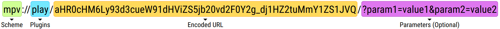

[English][readme-en] | [简体中文][readme-zh-hans] | [繁体中文][readme-zh-hant]

[readme-en]: https://github.com/akiirui/mpv-handler/blob/main/README.md
[readme-zh-hans]: https://github.com/akiirui/mpv-handler/blob/main/README.zh-Hans.md
[readme-zh-hant]: https://github.com/akiirui/mpv-handler/blob/main/README.zh-Hant.md

# mpv handler

一个 **mpv** 的协议处理程序，使用 Rust 编写。

使用 **mpv** 和 **yt-dlp** 播放网站上的视频与音乐。

请配合用户脚本使用：

[![play-with-mpv][badges-play-with-mpv]][greasyfork-play-with-mpv]

## 重大变更

### [v0.4.0][v0.4.0]

为了避免与 mpv 所提供的 `mpv://` 协议冲突。

> mpv://...
>
> mpv protocol. This is used for starting mpv from URL handler. The protocol is stripped and the rest is passed to the player as a normal open argument. Only safe network protocols are allowed to be opened this way.

协议 `mpv://` 和 `mpv-debug://` 已弃用, 请使用 `mpv-handler://` 和 `mpv-handler-debug://`.

**需要手动干预**

#### Windows

运行 `handler-uninstall.bat` 卸载已弃用的协议, 然后运行 `handler-install.bat` 安装新的协议.

#### Linux

如果你是手动安装的，请重新执行一遍手动安装流程。

## 协议



### 协议名

- `mpv-handler`: 在没有命令行窗口的情况下运行 mpv-handler
- `mpv-handler-debug`: 在有命令行窗口的情况下运行 mpv-handler 以便于查看输出和错误

### 插件 / Plugins

- `play`: 使用 mpv 播放视频

### 编码数据 / Encoded Data

使用 [URL 安全的 base64][rfc-base64-url] 编码网址或标题。

替换 `/` 至 `_`, `+` 至 `-` 并且删除填充的 `=`。

示例 (JavaScript):

```javascript
let data = btoa("https://www.youtube.com/watch?v=Ggkn2f5e-IU");
let safe = data.replace(/\//g, "_").replace(/\+/g, "-").replace(/\=/g, "");
```

### 参数 / Parameters (可选)

```
cookies  = [ www.domain.com.txt ]
profile  = [ default, low-latency, etc... ]
quality  = [ 2160p, 1440p, 1080p, 720p, 480p, 360p ]
v_codec  = [ av01, vp9, h265, h264 ]
v_title  = [ Encoded Title ]
subfile  = [ Encoded URL ]
startat  = [ Seconds (float) ]
referrer = [ Encoded URL ]
```

## 安装

### Linux

#### Arch Linux

[![mpv-handler][badges-aur]][download-aur]
[![mpv-handler-git][badges-aur-git]][download-aur-git]

#### 手动安装

1. 下载 [最新的 Linux 压缩包][download-linux]
2. 解压缩压缩包
3. 复制 `mpv-handler` 至 `$HOME/.local/bin`
4. 复制 `mpv-handler.desktop` 至 `$HOME/.local/share/applications/`
5. 复制 `mpv-handler-debug.desktop` 至 `$HOME/.local/share/applications/`
6. 为二进制文件设置可执行权限
   - ```
     $ chmod +x $HOME/.local/bin/mpv-handler
     ```

7. 注册 xdg-mime（感谢 [linuxuprising][linuxuprising] 和 [muse90673#122][muse90673]）
   - ```
     $ xdg-mime default mpv-handler.desktop x-scheme-handler/mpv-handler
     $ xdg-mime default mpv-handler-debug.desktop x-scheme-handler/mpv-handler-debug
     $ update-desktop-database $HOME/.local/share/applications/
     ```

8. 添加 `$HOME/.local/bin` 到环境变量 `PATH`
9. **可选**: _复制 `config.toml` 至 `$HOME/.config/mpv-handler/config.toml` 并配置_

### macOS

macOS 没有 `.desktop` 文件或注册表项那样的机制：协议处理程序必须是一个应用程序包（app bundle）。因此发布包里带有 `install.sh`，它会把二进制文件包装成 `mpv-handler.app`，做 ad-hoc 签名，并向 LaunchServices 注册这两个协议。

#### 手动安装

1. 下载 [最新的 macOS 压缩包][download-macos]
2. 解压缩压缩包
3. 运行 `install.sh`
   - ```
     $ sh install.sh
     ```

   - 应用包会安装到 `$HOME/Applications`，不需要管理员权限。加上 `-d /Applications` 可以为本机所有用户安装。
   - 请用 `sh install.sh` 运行。若你更喜欢直接 `./install.sh`，而 macOS 因压缩包带隔离属性而拒绝运行，先移除隔离属性：
     - ```
       $ xattr -dr com.apple.quarantine .
       ```

4. **可选**: _编辑 `$HOME/.config/mpv-handler/config.toml`_

二进制文件是通用二进制（universal binary），同一个压缩包在 Apple Silicon 和 Intel Mac 上都能运行。

#### 查找 mpv 和 yt-dlp

被 LaunchServices 启动的应用包只继承 `PATH=/usr/bin:/bin:/usr/sbin:/sbin`，包管理器安装的程序因此不可见。除了 `$PATH`，mpv-handler 还会查找 `/opt/homebrew/bin`、`/usr/local/bin`、`/opt/local/bin`、`$HOME/.local/bin`、`$HOME/bin`，以及 `/Applications/mpv.app` 和 `$HOME/Applications/mpv.app` 内部。用 [Homebrew][homebrew] 或 [MacPorts][macports] 安装 mpv 和 yt-dlp 即可自动找到；也可以在 `config.toml` 里设置 `mpv` 和 `ytdl` 覆盖。

#### 调试

被 LaunchServices 启动的应用包没有控制台，所以 `mpv-handler-debug://` 会打开 Terminal 并在其中运行命令行接口。首次使用时 macOS 会请求控制 Terminal 的权限。普通 `mpv-handler://` 出错时会弹出警告框，因为没有别的地方可以显示错误。

#### 卸载

- ```
  $ sh uninstall.sh
  ```

加上 `-c` 会一并删除 `$HOME/.config/mpv-handler/`，包括其中的 cookies。

### Windows

Windows 用户目前只能手动安装。

#### 手动安装

1. 下载 [最新的 Windows 压缩包][download-windows]
2. 解压缩档案到你想要的位置
3. 运行 `handler-install.bat` 注册协议处理程序
4. 编辑 `config.toml` 设置 `mpv` 和 `ytdl` 的路径

## 配置

```toml
mpv = "/usr/bin/mpv"
# 可选，类型：字符串
# mpv 可执行文件的路径
# 默认值:
# - Linux: mpv
# - macOS: mpv
# - Windows: mpv.com

ytdl = "/usr/bin/yt-dlp"
# 可选，类型：字符串
# yt-dlp 可执行文件的路径

proxy = "http://example.com:8080"
# 可选，类型：字符串
# HTTP(S) 代理服务器的地址

# 对于 Windows 用户：
#   - 路径格式可以是 "C:\\folder\\some.exe"，也可以是 "C:/folder/some.exe"
#   - 路径的目标是可执行二进制文件，而不是目录
```

[v0.4.0]: https://github.com/akiirui/mpv-handler/releases/tag/v0.4.0
[rfc-base64-url]: https://datatracker.ietf.org/doc/html/rfc4648#section-5
[badges-aur-git]: https://img.shields.io/aur/version/mpv-handler-git?style=for-the-badge&logo=archlinux&label=mpv-handler-git
[badges-aur]: https://img.shields.io/aur/version/mpv-handler?style=for-the-badge&logo=archlinux&label=mpv-handler
[badges-play-with-mpv]: https://img.shields.io/greasyfork/v/416271?style=for-the-badge&logo=greasyfork&label=play-with-mpv
[download-aur-git]: https://aur.archlinux.org/packages/mpv-handler-git/
[download-aur]: https://aur.archlinux.org/packages/mpv-handler/
[download-linux]: https://github.com/akiirui/mpv-handler/releases/latest/download/mpv-handler-linux-amd64.zip
[download-macos]: https://github.com/akiirui/mpv-handler/releases/latest/download/mpv-handler-macos-universal.zip
[download-windows]: https://github.com/akiirui/mpv-handler/releases/latest/download/mpv-handler-windows-amd64.zip
[greasyfork-play-with-mpv]: https://greasyfork.org/scripts/416271-play-with-mpv
[homebrew]: https://brew.sh/
[linuxuprising]: https://www.linuxuprising.com/2021/07/open-youtube-and-more-videos-from-your.html
[macports]: https://www.macports.org/
[muse90673]: https://github.com/akiirui/mpv-handler/issues/122
