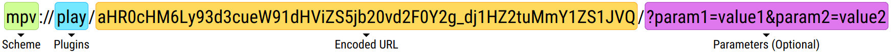

[English][readme-en] | [简体中文][readme-zh-hans] | [繁体中文][readme-zh-hant]

[readme-en]: https://github.com/akiirui/mpv-handler/blob/main/README.md
[readme-zh-hans]: https://github.com/akiirui/mpv-handler/blob/main/README.zh-Hans.md
[readme-zh-hant]: https://github.com/akiirui/mpv-handler/blob/main/README.zh-Hant.md

# mpv handler

一个 **mpv** 的协议处理程序，使用 Rust 编写。

使用 **mpv** 和 **yt-dlp** 播放网站上的视频与音乐。

请配合用户脚本使用：

[![play-with-mpv][badges-play-with-mpv]][greasyfork-play-with-mpv]

## 重大变更

### [v0.4.0][v0.4.0]

为了避免与 mpv 所提供的 `mpv://` 协议冲突。

> mpv://...
>
> mpv protocol. This is used for starting mpv from URL handler. The protocol is stripped and the rest is passed to the player as a normal open argument. Only safe network protocols are allowed to be opened this way.

协议 `mpv://` 和 `mpv-debug://` 已弃用, 请使用 `mpv-handler://` 和 `mpv-handler-debug://`.

**需要手动干预**

#### Windows

运行 `handler-uninstall.bat` 卸载已弃用的协议, 然后运行 `handler-install.bat` 安装新的协议.

#### Linux

如果你是手动安装的，请重新执行一遍手动安装流程。

## 协议



### 协议名

- `mpv-handler`: 在没有命令行窗口的情况下运行 mpv-handler
- `mpv-handler-debug`: 在有命令行窗口的情况下运行 mpv-handler 以便于查看输出和错误

### 插件 / Plugins

- `play`: 使用 mpv 播放视频

### 编码数据 / Encoded Data

使用 [URL 安全的 base64][rfc-base64-url] 编码网址或标题。

替换 `/` 至 `_`, `+` 至 `-` 并且删除填充的 `=`。

示例 (JavaScript):

```javascript
let data = btoa("https://www.youtube.com/watch?v=Ggkn2f5e-IU");
let safe = data.replace(/\//g, "_").replace(/\+/g, "-").replace(/\=/g, "");
```

### 参数 / Parameters (可选)

```
cookies  = [ www.domain.com.txt ]
profile  = [ default, low-latency, etc... ]
quality  = [ 2160p, 1440p, 1080p, 720p, 480p, 360p ]
v_codec  = [ av01, vp9, h265, h264 ]
v_title  = [ Encoded Title ]
subfile  = [ Encoded URL ]
startat  = [ Seconds (float) ]
referrer = [ Encoded URL ]
```

## 安装

### Linux

#### Arch Linux

[![mpv-handler][badges-aur]][download-aur]
[![mpv-handler-git][badges-aur-git]][download-aur-git]

#### 手动安装

1. 下载 [最新的 Linux 压缩包][download-linux]
2. 解压缩压缩包
3. 复制 `mpv-handler` 至 `$HOME/.local/bin`
4. 复制 `mpv-handler.desktop` 至 `$HOME/.local/share/applications/`
5. 复制 `mpv-handler-debug.desktop` 至 `$HOME/.local/share/applications/`
6. 为二进制文件设置可执行权限
   - ```
     $ chmod +x $HOME/.local/bin/mpv-handler
     ```

7. 注册 xdg-mime（感谢 [linuxuprising][linuxuprising] 和 [muse90673#122][muse90673]）
   - ```
     $ xdg-mime default mpv-handler.desktop x-scheme-handler/mpv-handler
     $ xdg-mime default mpv-handler-debug.desktop x-scheme-handler/mpv-handler-debug
     $ update-desktop-database $HOME/.local/share/applications/
     ```

8. 添加 `$HOME/.local/bin` 到环境变量 `PATH`
9. **可选**: _复制 `config.toml` 至 `$HOME/.config/mpv-handler/config.toml` 并配置_

### macOS

macOS 无法把裸的可执行文件注册为协议处理程序，因此必须把它包进一个 `.app`
bundle。`install.sh` 会组装这个 bundle、做 ad-hoc 签名，并向 LaunchServices 注册。

1. 安装 **mpv** 和 **yt-dlp**
   - ```
     $ brew install mpv yt-dlp
     ```

2. 按芯片架构解压 macOS 安装包。在包含 macOS 构建流程的分支上手动运行 GitHub Actions 后，
   可以从构建产物 `macos-packages` 中取得这两个压缩包。

   - Apple Silicon — `unzip mpv-handler-macos-arm64.zip -d mpv-handler-macos`
   - Intel — `unzip mpv-handler-macos-amd64.zip -d mpv-handler-macos`

3. 进入解压后的目录运行安装脚本
   - ```
     $ cd mpv-handler-macos
     $ sh install.sh ./mpv-handler
     ```

   bundle 会被安装到 `$HOME/Applications`，该位置不需要管理员权限。传入第二个
   参数可为本机的所有用户安装
   - ```
     $ sh install.sh ./mpv-handler /Applications
     ```

4. **可选**: _复制 `config.toml` 至 `${XDG_CONFIG_HOME:-$HOME/.config}/mpv-handler/config.toml` 并配置_

个人安装时，如果 shell 中的 `$XDG_CONFIG_HOME` 是绝对路径，`install.sh` 会保存该路径，
供从浏览器打开链接时使用。设置、更改或取消该变量后，请重新运行 `install.sh`。
共享安装在 `/Applications` 时，应用启动后从当前用户的环境读取 `$XDG_CONFIG_HOME`。
如果它是绝对路径，就使用该路径，否则使用该用户的 `~/.config`。

从源码安装时，请使用含 `share/macos/install.sh` 的源码版本。
在仓库根目录运行 `cargo build --release --locked`，再运行 `sh share/macos/install.sh`。

卸载运行 `sh uninstall.sh`；如果安装目录不是 `$HOME/Applications`，把它作为参数
传入。脚本会先注销再删除，这个顺序很重要：LaunchServices 会为已不存在的路径保留
一条协议声明，而这条残留声明的解析优先级高于正常安装，会让协议失效。

打开 `mpv-handler-debug://` 链接时，系统会为这次播放启动一个独立的“终端”进程，
直接运行 mpv-handler。窗口显示 handler 和 mpv 的输出与错误，正常播放的首行是
`Binaries:`。以下测试链接的编码数据不完整，会显示
`Failed to decode`。

```sh
open 'mpv-handler-debug://play/A'
```

从 LaunchServices 启动时，mpv-handler 会在继承的 `PATH` 中追加
`/opt/homebrew/bin`、`/usr/local/bin`、`/opt/local/bin` 和 `$HOME/.local/bin`，
以便找到通过 Homebrew 或 MacPorts 安装的程序。也可以在 `config.toml` 中指定
`mpv` 和 `ytdl` 的路径。

下载的压缩包带有 `com.apple.quarantine` 属性，`install.sh` 会在组装 bundle 时清除
它，因此 Gatekeeper 不会报告应用已损坏。签名是 ad-hoc 的：在 Apple Silicon 上本地
运行足够，但 bundle 并未经过公证。

### Windows

Windows 用户目前只能手动安装。

#### 手动安装

1. 下载 [最新的 Windows 压缩包][download-windows]
2. 解压缩档案到你想要的位置
3. 运行 `handler-install.bat` 注册协议处理程序
4. 编辑 `config.toml` 设置 `mpv` 和 `ytdl` 的路径

## 配置

```toml
mpv = "/usr/bin/mpv"
# 可选，类型：字符串
# mpv 可执行文件的路径
# 默认值:
# - Linux: mpv
# - macOS: mpv
# - Windows: mpv.com

ytdl = "/usr/bin/yt-dlp"
# 可选，类型：字符串
# yt-dlp 可执行文件的路径

proxy = "http://example.com:8080"
# 可选，类型：字符串
# HTTP(S) 代理服务器的地址

# 对于 Windows 用户：
#   - 路径格式可以是 "C:\\folder\\some.exe"，也可以是 "C:/folder/some.exe"
#   - 路径的目标是可执行二进制文件，而不是目录
```

[v0.4.0]: https://github.com/akiirui/mpv-handler/releases/tag/v0.4.0
[rfc-base64-url]: https://datatracker.ietf.org/doc/html/rfc4648#section-5
[badges-aur-git]: https://img.shields.io/aur/version/mpv-handler-git?style=for-the-badge&logo=archlinux&label=mpv-handler-git
[badges-aur]: https://img.shields.io/aur/version/mpv-handler?style=for-the-badge&logo=archlinux&label=mpv-handler
[badges-play-with-mpv]: https://img.shields.io/greasyfork/v/416271?style=for-the-badge&logo=greasyfork&label=play-with-mpv
[download-aur-git]: https://aur.archlinux.org/packages/mpv-handler-git/
[download-aur]: https://aur.archlinux.org/packages/mpv-handler/
[download-linux]: https://github.com/akiirui/mpv-handler/releases/latest/download/mpv-handler-linux-amd64.zip
[download-windows]: https://github.com/akiirui/mpv-handler/releases/latest/download/mpv-handler-windows-amd64.zip
[greasyfork-play-with-mpv]: https://greasyfork.org/scripts/416271-play-with-mpv
[linuxuprising]: https://www.linuxuprising.com/2021/07/open-youtube-and-more-videos-from-your.html
[muse90673]: https://github.com/akiirui/mpv-handler/issues/122
