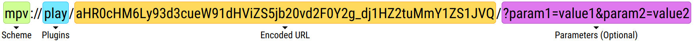

[English][readme-en] | [簡體中文][readme-zh-hans] | [繁體中文][readme-zh-hant]

[readme-en]: https://github.com/akiirui/mpv-handler/blob/main/README.md
[readme-zh-hans]: https://github.com/akiirui/mpv-handler/blob/main/README.zh-Hans.md
[readme-zh-hant]: https://github.com/akiirui/mpv-handler/blob/main/README.zh-Hant.md

# mpv handler

一個 **mpv** 的協議處理程序，使用 Rust 編寫。

使用 **mpv** 和 **yt-dlp** 播放網站上的視頻與音樂。

請配合用戶腳本使用：

[![play-with-mpv][badges-play-with-mpv]][greasyfork-play-with-mpv]

## 重大變更

### [v0.4.0][v0.4.0]

爲了避免與 mpv 所提供的 `mpv://` 協議衝突。

> mpv://...
>
> mpv protocol. This is used for starting mpv from URL handler. The protocol is stripped and the rest is passed to the player as a normal open argument. Only safe network protocols are allowed to be opened this way.

協議 `mpv://` 和 `mpv-debug://` 已棄用, 請使用 `mpv-handler://` 和 `mpv-handler-debug://`.

**需要手動干預**

#### Windows

運行 `handler-uninstall.bat` 卸載已棄用的協議, 然後運行 `handler-install.bat` 安裝新的協議.

#### Linux

如果你是手動安裝的，請重新執行一遍手動安裝流程。

## 協議



### 協議名

- `mpv-handler`: 在沒有命令行窗口的情況下運行 mpv-handler
- `mpv-handler-debug`: 在有命令行窗口的情況下運行 mpv-handler 以便於查看輸出和錯誤

### 插件 / Plugins

- `play`: 使用 mpv 播放視頻

### 編碼數據 / Encoded Data

使用 [URL 安全的 base64][rfc-base64-url] 編碼網址或標題。

替換 `/` 至 `_`, `+` 至 `-` 並且刪除填充的 `=`。

示例 (JavaScript):

```javascript
let data = btoa("https://www.youtube.com/watch?v=Ggkn2f5e-IU");
let safe = data.replace(/\//g, "_").replace(/\+/g, "-").replace(/\=/g, "");
```

### 參數 / Parameters (可選)

```
cookies  = [ www.domain.com.txt ]
profile  = [ default, low-latency, etc... ]
quality  = [ 2160p, 1440p, 1080p, 720p, 480p, 360p ]
v_codec  = [ av01, vp9, h265, h264 ]
v_title  = [ Encoded Title ]
subfile  = [ Encoded URL ]
startat  = [ Seconds (float) ]
referrer = [ Encoded URL ]
```

## 安裝

### Linux

#### Arch Linux

[![mpv-handler][badges-aur]][download-aur]
[![mpv-handler-git][badges-aur-git]][download-aur-git]

#### 手動安裝

1. 下載 [最新的 Linux 壓縮包][download-linux]
2. 解壓縮壓縮包
3. 複製 `mpv-handler` 至 `$HOME/.local/bin`
4. 複製 `mpv-handler.desktop` 至 `$HOME/.local/share/applications/`
5. 複製 `mpv-handler-debug.desktop` 至 `$HOME/.local/share/applications/`
6. 爲二進制文件設置可執行權限
   - ```
     $ chmod +x $HOME/.local/bin/mpv-handler
     ```

7. 註冊 xdg-mime（感謝 [linuxuprising][linuxuprising] 和 [muse90673#122][muse90673]）
   - ```
     $ xdg-mime default mpv-handler.desktop x-scheme-handler/mpv-handler
     $ xdg-mime default mpv-handler-debug.desktop x-scheme-handler/mpv-handler-debug
     $ update-desktop-database $HOME/.local/share/applications/
     ```

8. 添加 `$HOME/.local/bin` 到環境變量 `PATH`
9. **可選**: _複製 `config.toml` 至 `$HOME/.config/mpv-handler/config.toml` 並配置_

### macOS

1. 安裝 mpv 和 yt-dlp。使用 Homebrew 可執行 `brew install mpv yt-dlp`。
2. 解壓縮 [macOS 安裝包][download-macos]，將 `mpv-handler.app` 拖入「應用程式」，開啟一次即可註冊兩個通訊協定。

<details>
<summary>如果 macOS 提示 Apple 無法驗證 mpv-handler</summary>

先按一下「完成」。如果你信任下載來源，請開啟「系統設定」→「隱私權與安全性」，在「安全性」中找到 `mpv-handler`，按一下「強制打開」並確認。如果沒有看到這個按鈕，請在 Finder 中再按兩下該 App，然後返回設定查看。[Apple 官方說明](https://support.apple.com/zh-tw/102445)

</details>

首次開啟偵錯連結時，macOS 可能會詢問是否允許 mpv-handler 控制「終端機」。按一下「允許」即可查看播放記錄。一般播放不需要這項權限。

和 Linux 一樣，應用程式從 `~/.config/mpv-handler/config.toml` 和 `~/.config/mpv-handler/cookies/` 讀取設定與 cookies。若應用程式環境中的 `XDG_CONFIG_HOME` 是絕對路徑，則用它取代 `~/.config`。

解除安裝時，在 `~/Applications` 或 `/Applications` 中找到 `mpv-handler.app`，將它移到垃圾桶即可。個人設定和 cookies 會保留。

若要為本機架構建置，可在專案根目錄執行 `cargo build --release --locked && sh share/macos/bundle.sh target/release/mpv-handler mpv-handler.app`。通用 App 的建置步驟請見[發布工作流程](.github/workflows/build.yml)。

### Windows

Windows 用戶目前只能手動安裝。

#### 手動安裝

1. 下載 [最新的 Windows 壓縮包][download-windows]
2. 解壓縮檔案到你想要的位置
3. 運行 `handler-install.bat` 註冊協議處理程序
4. 編輯 `config.toml` 設置 `mpv` 和 `ytdl` 的路徑

## 配置

```toml
mpv = "/usr/bin/mpv"
# 可選，類型：字符串
# mpv 可執行文件的路徑
# 默認值:
# - Linux/macOS: mpv
# - Windows: mpv.com

ytdl = "/usr/bin/yt-dlp"
# 可選，類型：字符串
# yt-dlp 可執行文件的路徑

proxy = "http://example.com:8080"
# 可選，類型：字符串
# HTTP(S) 代理服務器的地址

# 對於 Windows 用戶：
#   - 路徑格式可以是 "C:\\folder\\some.exe"，也可以是 "C:/folder/some.exe"
#   - 路徑的目標是可執行二進制文件，而不是目錄
```

[v0.4.0]: https://github.com/akiirui/mpv-handler/releases/tag/v0.4.0
[rfc-base64-url]: https://datatracker.ietf.org/doc/html/rfc4648#section-5
[badges-aur-git]: https://img.shields.io/aur/version/mpv-handler-git?style=for-the-badge&logo=archlinux&label=mpv-handler-git
[badges-aur]: https://img.shields.io/aur/version/mpv-handler?style=for-the-badge&logo=archlinux&label=mpv-handler
[badges-play-with-mpv]: https://img.shields.io/greasyfork/v/416271?style=for-the-badge&logo=greasyfork&label=play-with-mpv
[download-aur-git]: https://aur.archlinux.org/packages/mpv-handler-git/
[download-aur]: https://aur.archlinux.org/packages/mpv-handler/
[download-linux]: https://github.com/akiirui/mpv-handler/releases/latest/download/mpv-handler-linux-amd64.zip
[download-macos]: https://github.com/akiirui/mpv-handler/releases/latest/download/mpv-handler-macos-universal.zip
[download-windows]: https://github.com/akiirui/mpv-handler/releases/latest/download/mpv-handler-windows-amd64.zip
[greasyfork-play-with-mpv]: https://greasyfork.org/scripts/416271-play-with-mpv
[linuxuprising]: https://www.linuxuprising.com/2021/07/open-youtube-and-more-videos-from-your.html
[muse90673]: https://github.com/akiirui/mpv-handler/issues/122
